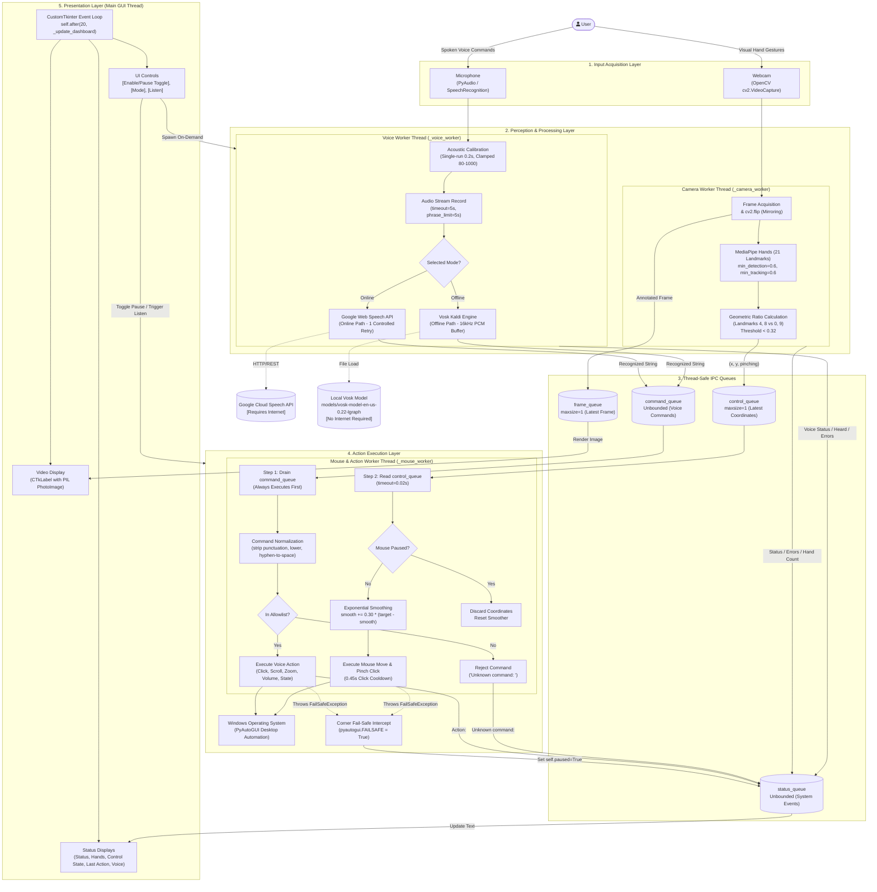

# AirControl — Software Architecture Specification

This document provides an exhaustive, source-code-accurate description of the software architecture of **AirControl**. It explains the internal data pipelines, concurrent threading topology, queue-based inter-process communication (IPC), subsystem decoupling, error-recovery mechanisms, and hardware safety layers.

---

## 1. System Overview & Architectural Goals

AirControl is a real-time, multi-modal desktop interaction system that translates natural human gestures (via webcam) and spoken commands (via microphone) into operating system actions on Windows.

### Architectural Goals:
1. **Zero UI Latency:** The graphical interface must remain responsive at ~50–60 FPS regardless of blocking I/O (speech recognition, network queries) or intensive CPU computation (computer vision).
2. **True Modality Decoupling:** Voice control and gesture control must operate independently. Voice commands must continue to execute even if the camera is disconnected, uninitialized, or if gesture tracking is paused.
3. **Graceful Degradation:** The voice subsystem must operate both online (high-accuracy cloud recognition) and offline (local Kaldi-based neural model) without code alterations or crashes.
4. **Deterministic Safety:** Desktop automation must prevent runaway cursor movements, reject arbitrary or dangerous commands, and honor emergency fail-safes.

---

## 2. System Architecture Diagram

The following GitHub-compatible Mermaid diagram illustrates the actual components, background worker threads, FIFO queues, data flow, external dependencies, and execution paths in AirControl.



---

## 3. End-to-End System Workflow Explained

### Phase 1: Input Ingestion
1. **Vision:** The user places their hand in front of the camera. The `_camera_worker` daemon acquires 640x480 video frames via OpenCV using the Windows DirectShow backend.
2. **Audio:** When the user clicks "Listen for Command", `_start_voice` sets `voice_busy = True` and spawns `_voice_worker` in a daemon thread. The microphone opens via PyAudio and records until a phrase boundary or timeout occurs.

### Phase 2: Perception & Interpretation
1. **Vision:** OpenCV flips the frame horizontally for intuitive mirroring and passes it to MediaPipe Hands. MediaPipe returns 21 3D hand landmarks.
   - Landmark 8 (index tip) provides normalized screen target coordinates.
   - Landmarks 4 (thumb tip), 0 (wrist), and 9 (middle MCP) calculate the scale-invariant pinch ratio.
   - If `pinch_ratio < 0.32`, pinch state is flagged as `True`.
2. **Audio:** The audio buffer is routed to either Google Cloud STT (Online) or local Vosk Kaldi (Offline).
   - If recognized, the raw transcribed text is queued to `command_queue`.
   - If speech is unintelligible, the online engine attempts one controlled retry before returning an error message to `status_queue`.

### Phase 3: Action Selection & Normalization
1. Inside `_mouse_worker`, `command_queue` is drained completely prior to processing any gesture coordinates.
2. The recognized string is normalized:
   - Stripped of all ASCII punctuation.
   - Hyphens converted to single spaces.
   - Collapsed whitespace and lowercased.
3. The normalized text is checked against the hardcoded command allowlist.
   - Valid commands execute system actions immediately via PyAutoGUI.
   - Invalid phrases are rejected without performing any desktop side-effects.

### Phase 4: Cursor Smoothing & Execution
1. If mouse control is **not paused**, the worker retrieves coordinates from `control_queue`.
2. Coordinates are bounded between 8% and 92% of the frame and mapped to the physical display resolution with a 20px edge margin.
3. An exponential moving average (`smooth += 0.30 * (target - smooth)`) dampens micro-tremors.
4. `pyautogui.moveTo()` positions the cursor.
5. If a transition from unpinched to pinched occurs and cooldown exceeds 0.45s, `pyautogui.click()` is triggered.

### Phase 5: Feedback & Status Delivery
1. The main UI thread executes `_update_dashboard()` every 20ms (~50 times per second).
2. It drains `status_queue` and updates CustomTkinter string variables (`status_var`, `hand_var`, `control_var`, `last_action_var`, `voice_status_var`).
3. It pops the latest image from `frame_queue`, converts it via Pillow, and updates the UI canvas label.

---

## 4. Architectural Layers & Responsibilities

| Layer | Primary Module | Responsibilities | Key Dependencies |
| :--- | :--- | :--- | :--- |
| **Presentation Layer** | `main.py` (`AirControlApp`) | GUI layout, dark mode rendering, user button interactions, periodic dashboard polling (~50Hz) | `customtkinter`, `PIL.Image`, `PIL.ImageTk` |
| **Input Acquisition Layer** | `main.py`, `voice/voice_controller.py` | DirectShow camera acquisition, audio stream ingestion, hardware device failure detection | `cv2.VideoCapture`, `speech_recognition.Microphone` |
| **Perception Layer** | `main.py`, `voice/voice_controller.py` | 21 3D hand landmark inference, pinch ratio calculation, online/offline speech-to-text | `mediapipe.solutions.hands`, `vosk.KaldiRecognizer`, `recognize_google` |
| **Command Processing Layer** | `main.py` (`_execute_voice_command`) | Punctuation stripping, string normalization, allowlist validation, security rejection of arbitrary phrases | Python standard library (`string`, `re`) |
| **Action Execution Layer** | `main.py` (`_mouse_worker`) | Exponential cursor smoothing, coordinate bounding, click cooldown timing, OS mouse/keyboard synthesis | `pyautogui` |
| **Concurrency Layer** | `main.py` | Daemon thread management, non-blocking queue synchronization, stale frame/coordinate dropping | `threading`, `queue` |
| **Reliability & Safety Layer** | `main.py`, `voice/voice_controller.py` | Emergency fail-safe interception, camera reconnect loops, mic error propagation, Vosk model validation | `pyautogui.FAILSAFE`, try/except boundaries |

---

## 5. Detailed Workflows

### 5.1 Gesture Processing Pipeline
```
[Webcam Frame 640x480]
          │
          ▼
[cv2.flip(frame, 1)] (Mirroring)
          │
          ▼
[cv2.cvtColor to RGB]
          │
          ▼
[MediaPipe Hands Inference] ──► Extracts 21 Landmarks
          │
          ▼
[Landmark Geometry Analysis]:
   ├─ Index Tip: Landmark 8 (x, y)
   ├─ Thumb Tip: Landmark 4 (x, y)
   ├─ Wrist: Landmark 0 (x, y)
   └─ Middle MCP: Landmark 9 (x, y)
          │
          ▼
[Ratio Computation]:
   pinch_distance = hypot(index_x - thumb_x, index_y - thumb_y)
   palm_size = hypot(mcp_x - wrist_x, mcp_y - wrist_y)
   pinch_ratio = pinch_distance / palm_size
   pinching = pinch_ratio < 0.32
          │
          ▼
[Annotate Frame & Draw Skeleton]
          │
          ▼
[Push to control_queue (maxsize=1)] ──► Discards previous sample if unprocessed
```

### 5.2 Voice Processing Pipeline
```
[User clicks 'Listen for Command']
          │
          ▼
[_start_voice spawns _voice_worker(mode)]
          │
          ▼
[Single Ambient Noise Calibration (duration=0.2s, clamped 80-1000)]
          │
          ▼
[Microphone.listen(timeout=5s, phrase_time_limit=5s)]
          │
   ┌──────┴─────────────────────────────────┐
   ▼                                        ▼
[Online Mode (Google STT)]       [Offline Mode (Vosk)]
   │                                        │
   ├─ Network API Call                      ├─ Extract raw 16kHz PCM bytes
   ├─ On UnknownValueError:                 ├─ KaldiRecognizer.AcceptWaveform()
   │    Controlled 1-retry                  └─ json.loads(FinalResult())["text"]
   └─ On RequestError: Suggest Offline      │
   │                                        │
   └──────────────────┬─────────────────────┘
                      ▼
[Raw Transcription String]
                      │
                      ▼
[Normalization: lowercase, replace hyphens, strip punctuation]
                      │
                      ▼
[Allowlist Check]:
   ├─ "click" / "left click"     ──► pyautogui.click()
   ├─ "double click"            ──► pyautogui.doubleClick()
   ├─ "right click"             ──► pyautogui.rightClick()
   ├─ "scroll up" / "down"      ──► pyautogui.scroll(±200)
   ├─ "zoom in" / "out"         ──► pyautogui.hotkey('ctrl', '±')
   ├─ "volume up" / "down"      ──► pyautogui.press('volumeup/down')
   ├─ "mute" / "unmute"         ──► pyautogui.press('volumemute')
   ├─ "move left" / "right"     ──► pyautogui.move(±100, 0)
   ├─ "pause" / "resume"        ──► self.paused = True / False
   └─ <any other text>          ──► Log "Unknown command" (No-op)
```

---

## 6. Subsystem Decoupling & Independent Operation

A critical architectural achievement in AirControl is the **complete decoupling of voice and gesture controls**:

1. **Independent Execution:** Voice commands are processed in `_mouse_worker` by draining `command_queue` before attempting to read `control_queue`.
2. **State Independence:** The `self.paused` boolean controls *only* gesture-driven cursor movement and pinch-clicking. When `self.paused == True`, the user can still speak `"scroll down"`, `"zoom in"`, `"volume up"`, or `"double click"`, and those actions execute immediately.
3. **Hardware Independence:** If the webcam fails to open, is disconnected, or drops frames, `_mouse_worker` still processes voice commands normally without waiting for camera frames.

---

## 7. Concurrency, Queue Dynamics & Thread Safety

| Queue Name | Direction | Capacity | Eviction Policy | Rationale |
| :--- | :--- | :--- | :--- | :--- |
| `frame_queue` | `_camera_worker` ➔ UI Thread | `1` | Drop-oldest (`put_nowait` with catch `Full`) | Prevents video lag; UI only ever displays the freshest video frame. |
| `control_queue` | `_camera_worker` ➔ `_mouse_worker` | `1` | Drop-oldest via `_publish_control` | Eliminates cursor rubber-banding; ensures cursor targets current hand position. |
| `command_queue` | `_voice_worker` ➔ `_mouse_worker` | Unbounded | FIFO | Guarantees every recognized voice command is processed without loss. |
| `status_queue` | All Workers ➔ UI Thread | Unbounded | FIFO | Captures every system state change, action event, and error notification. |

### Thread-Safety Considerations:
- **GUI Access:** Tkinter widget methods are accessed exclusively by the main thread. Background workers communicate strictly via `status_queue`, `frame_queue`, and `command_queue`.
- **Atomic State Updates:** Global flags (`running`, `paused`, `voice_busy`) are primitive Python booleans protected by the Global Interpreter Lock (GIL) and checked safely across loops.

---

## 8. Reliability, Safety & Error Handling

1. **PyAutoGUI Emergency Corner Fail-Safe:**
   - `pyautogui.FAILSAFE = True` is enforced globally.
   - If the user moves the physical mouse to `(0, 0)` (top-left corner), PyAutoGUI throws `FailSafeException`.
   - `_mouse_worker` catches this exception, immediately sets `self.paused = True`, and notifies the user via the UI.
2. **Camera Reconnection Loop:**
   - Detects dropped frames via `consecutive_drops`.
   - At 10 dropped frames, warns the user.
   - At 25 dropped frames, safely releases the hardware handle and re-attempts DirectShow initialization.
3. **Microphone Energy Clamping:**
   - Ambient noise calibration sets `energy_threshold`, but clamps it strictly between `80` and `1000`.
   - This prevents the microphone from becoming permanently desensitized if a loud noise occurs during the 0.2s calibration window.
4. **Offline Model Validation:**
   - The Vosk model path is verified prior to opening the microphone, providing an instant diagnostic message rather than timing out on an empty audio stream.

---

## 9. Architectural Limitations & Future Scope

| Current Architecture | Limitation | Planned Future Enhancement |
| :--- | :--- | :--- |
| **Rule-Based Pinch Detection** | Sensitive to extreme hand angles or camera occlusion | Train a lightweight multi-gesture classification model (Open, Pinch, Fist, Peace). |
| **Single Push-to-Talk Button** | Requires physical click to trigger voice recognition | Implement continuous wake-word listening (e.g., *"Hey AirControl"* using openWakeWord). |
| **Fixed Smoothing Parameter (0.30)** | Trade-off between cursor responsiveness and jitter suppression | Implement a 1€ (One Euro) adaptive filter that adjusts smoothing based on movement velocity. |
| **Hardcoded Command Mapping** | Command dictionary is static in `main.py` | Add a JSON/YAML configuration file allowing users to customize phrases and desktop hotkeys. |
