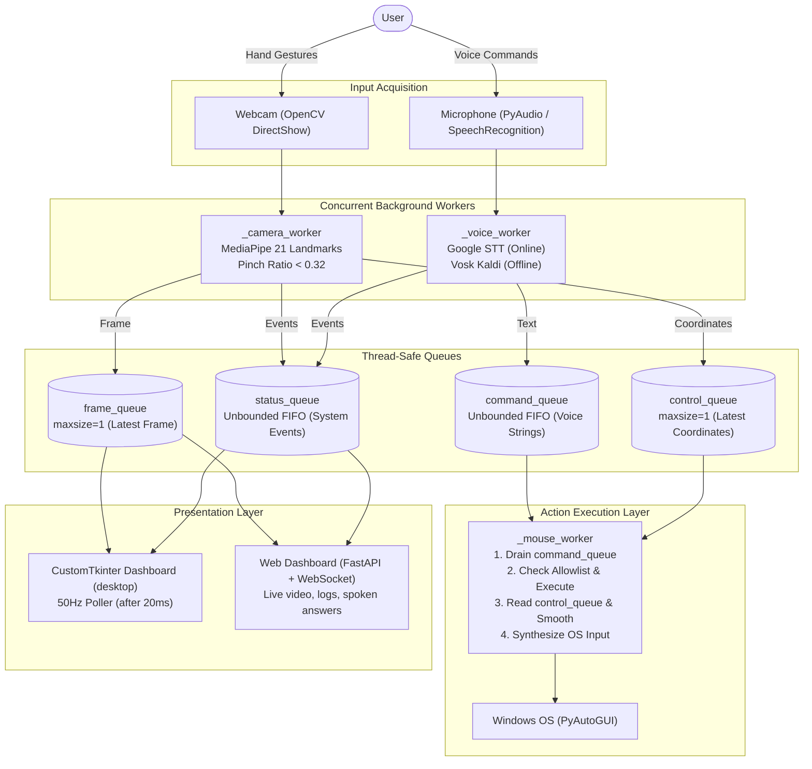

# AIRCONTROL

> **Touch-Free Multimodal Desktop Interaction via Real-Time Computer Vision and Decoupled Speech Control.**

[](https://www.python.org/)
[](https://opencv.org/)
[](https://mediapipe.dev/)
[](https://github.com/TomSchimansky/CustomTkinter)
[](https://alphacephei.com/vosk/)
[](https://ai.google.dev/)
[](https://pytest.org/)
[](https://www.microsoft.com/windows)

Built for the **Tri-City AI-Thon** (KITS Warangal, 24-hour hackathon).

---

## 1. Project Identity & Overview

- **Project Name:** AirControl
- **Tagline:** Touch-Free Multimodal Desktop Interaction via Real-Time Computer Vision and Decoupled Speech Control
- **Visual Direction:** Japanese Minimal × Swiss Engineering (Warm Ivory, Charcoal Ink, Deep Indigo, Vermilion Red, Muted Stone, Soft Sage)
- **Project Category:** Assistive Technology / Human-Computer Interaction (HCI) / Computer Vision
- **Target Audience:** Users with motor or physical mobility limitations, professionals in sterile environments (medical, lab, culinary), presenters and teachers, and power users seeking touch-free computing.
- **Primary Objective:** Provide a seamless, robust and safe alternative to conventional mouse and keyboard peripherals by combining continuous hand-gesture tracking with discrete, allowlisted voice commands in a single application.

---

## 2. Problem Statement & Proposed Solution

### The Problem
Conventional desktop computing is tethered to physical mice and keyboards:
- **Accessibility barriers:** People with motor disabilities, repetitive strain injury (RSI), arthritis or a temporary injury face strain or exclusion.
- **Sterile and contaminated environments:** In operating rooms, laboratories, cleanrooms and kitchens, touching peripherals adds contamination risk.
- **Physical tethering:** Presenters and educators must stay near the laptop to change slides or scroll.

### The Proposed Solution
AirControl is a unified, multimodal application that combines:
1. **Continuous visual input:** a live webcam stream analyzed by MediaPipe (21 3D hand landmarks), smoothed with an adaptive **1€ filter** (Casiez, CHI 2012) and anchored by **Schmitt-trigger pinch hysteresis**.
2. **Discrete voice control:** online recognition (Google speech) for accuracy, or offline recognition (Vosk Kaldi) for privacy, feeding a safe **Command Router** that executes only allowlisted desktop actions.
3. **Decoupled architecture:** background worker threads and FIFO queues keep voice commands working even when mouse tracking is paused or the webcam is disconnected.
4. **Optional AI assistant:** Gemini can answer questions and interpret flexible requests into registered actions only, never into arbitrary code.

---

## 3. Key Features

### Core features (verified against the codebase and covered by automated tests)

- [x] **Real-time hand tracking:** 30 FPS landmark tracking with MediaPipe Hands, with horizontal mirror flipping.
- [x] **Adaptive 1€ filter smoothing:** velocity-responsive filtering that removes jitter at rest and lag during fast sweeps.
- [x] **Schmitt-trigger pinch hysteresis:** dual threshold (`down < 0.28`, `up > 0.35`) to stop contact chatter.
- [x] **Click-freeze anchor:** 120 ms position lock on pinch-down so squeezing the fingers does not move the cursor.
- [x] **Tracking-loss grace hold:** keeps the last filtered position across brief occlusions (about 130 ms).
- [x] **Application launching (allowlist):** Chrome, Notepad and Calculator launched with argument lists, never `shell=True`.
- [x] **Website tab navigation:** "Open LinkedIn / GitHub / YouTube in Chrome".
- [x] **Command deduplication:** 0.6 s debounce against accidental double triggers.
- [x] **Japanese Minimal × Swiss Engineering interface:** restrained palette, bundled Space Grotesk font (SIL OFL license in `ui/assets/fonts/`), numbered section labels, monospaced telemetry and a `● REC` indicator.
- [x] **Chronological telemetry audit log:** timestamps, input source, action and status.
- [x] **Live parameter calibration:** sliders for sensitivity, 1€ filter cutoff and click debounce.
- [x] **Online voice control:** Google Speech Recognition with an automatic one-time retry.
- [x] **100% offline voice control:** embedded Vosk engine (`vosk-model-en-us-0.22-lgraph`) on 16 kHz PCM audio, no internet needed.
- [x] **Safe assistant actions:** validated capability registry, bounded file search, text entry, accessibility settings, task progress/cancellation, and confirmation for consequential actions.
- [x] **Optional AI chat and intent:** Gemini answers questions and maps flexible requests to registered actions. It cannot execute shell commands or code.
- [x] **Subsystem decoupling:** voice works independently of camera state and the mouse pause toggle.
- [x] **Hardware pause and PyAutoGUI fail-safe:** UI button, voice commands ("pause control", "resume control") and the emergency corner slam at `(0, 0)`.
- [x] **Full-screen webcam preview.**

### Latest additions (web dashboard and extended controls)

- **Web dashboard:** FastAPI + WebSocket backend (`backend/web_server.py`, `backend/engine.py`) streaming the camera feed, landmarks, audit log and calibration values to a browser dashboard with animated components (heading animation, blur-in text, card hover effects, cursor glow trail, animated background).
- **Spoken answers:** chatbot answers are shown as text and spoken aloud with the browser's built-in Chrome voice (Web Speech API), with an on/off toggle and a stop button. The microphone is ignored while the answer is speaking, so the app never hears itself.
- **Fifteen gesture shortcuts** (table in section 7), held steady and rate-limited so one hold sends one keypress.
- **Live scroll and zoom** by voice and gesture.
- **Hands-free wake phrases:** "Hey AirControl, start listening" and "Hey AirControl, stop listening".

---

## 4. Software Architecture Overview

AirControl separates concerns across 5 logical layers connected by thread-safe FIFO queues:



The presentation layer has two front ends over the same engine: the original CustomTkinter desktop app and the browser dashboard served by FastAPI.

For the complete specification, see [ARCHITECTURE.md](ARCHITECTURE.md).

---

## 5. Technology Stack Summary

| Technology | Role in AirControl | Where Used | Key Advantage |
| :--- | :--- | :--- | :--- |
| **Python 3.12** | Core language and runtime coordinator | Entire codebase | High-level concurrency primitives; rich CV and audio ecosystem. |
| **OpenCV (`cv2`)** | Frame capture, mirroring, preprocessing | `main.py`, `backend/engine.py` | DirectShow low-latency camera access on Windows. |
| **MediaPipe 0.10.14** | 21 3D hand landmark inference | `main.py`, `backend/engine.py` | Real-time on-device model on CPU. Pinned because newer releases removed `mp.solutions`. |
| **SpeechRecognition** | Audio capture and cloud STT interface | `voice/voice_controller.py` | Unified microphone streaming with energy-threshold calibration. |
| **Google Speech API** | Online speech-to-text | `voice/voice_controller.py` | Zero-configuration transcription with a controlled retry. |
| **Vosk** | Offline speech-to-text | `voice/voice_controller.py` | 100% offline, privacy-first Kaldi model. |
| **PyAutoGUI** | OS mouse and keyboard automation | `main.py`, `backend/engine.py` | Desktop input synthesis with emergency fail-safe. |
| **CustomTkinter** | Desktop dark-mode interface | `main.py` | Modern UI without webview bloat. |
| **FastAPI + Uvicorn + WebSockets** | Web dashboard backend and live streaming | `backend/web_server.py` | Low-latency push of video frames, logs and status to the browser. |
| **Google Gemini (`google-genai`)** | Optional AI answers and intent interpretation | AI interpreter layer | Flexible language understanding, restricted to registered actions. |
| **Web Speech API (Chrome)** | Spoken chatbot answers | Web dashboard | Built-in voices, no API key needed. |
| **Pytest** | Automated unit and integration tests | `tests/` | Deterministic verification with hardware mocks. |

For detailed analysis, see [docs/TECH_STACK.md](docs/TECH_STACK.md).

---

## 6. Project Directory Structure

```
AirControl/
├── .gitignore                      # Ignore patterns (.venv312, .env, models, caches)
├── .env.example                    # Template for optional AI configuration
├── requirements.txt                # Python package dependencies
├── main.py                         # Desktop app entry point, GUI and worker coordination
├── backend/                        # Web dashboard backend
│   ├── __init__.py
│   ├── engine.py                   # Camera, gesture and voice engine for the web dashboard
│   └── web_server.py               # FastAPI app and WebSocket endpoints
├── frontend/                       # Web dashboard UI (animated components)
├── voice/                          # Speech recognition subsystem
│   ├── __init__.py
│   └── voice_controller.py         # Dual-mode VoiceController (Online + Offline Vosk)
├── models/                         # Neural model storage
│   └── vosk-model-en-us-0.22-lgraph/
├── tests/                          # Automated test suite
│   ├── __init__.py
│   ├── test_commands.py            # Command normalization, allowlist and safety tests
│   ├── test_decoupling.py          # State decoupling and worker loop tests
│   └── test_voice.py               # Online/offline speech and hardware error tests
├── docs/
│   ├── ARCHITECTURE.md
│   ├── PRESENTATION_GUIDE.md
│   ├── TECH_STACK.md
│   ├── USER_GUIDE.md
│   └── TESTING.md
├── ARCHITECTURE.md                 # Complete software architecture specification
├── PRESENTATION.md                 # Hackathon pitch script and jury Q&A
└── README.md                       # This file
```

---

## 7. Supported Gestures and Voice Commands

### Cursor gestures
| Gesture | Trigger Condition | Resulting Desktop Action |
| :--- | :--- | :--- |
| **Point & Move** | Index fingertip (landmark 8) in camera frame | Moves the system cursor with 1€-filter smoothing. |
| **Pinch Click** | Thumb-tip to index-tip distance ratio `< 0.32` | Left click at the current pointer position (0.45 s cooldown). |

### Gesture shortcuts (finger-pattern keys)
| Gesture shape | Action Triggered |
| :--- | :--- |
| Thumb + Index | Right Arrow |
| Thumb + Index + Pinky | Left Arrow |
| Index only | Space |
| Middle only | `Z` |
| Thumb + Index + Middle | `M` |
| Thumb only | Enter |
| Index + Middle | Up Arrow |
| Index + Pinky | Down Arrow |
| Index + Middle + Ring | Ctrl + F4 |
| Pinky only | Ctrl + T |
| 4 fingers (no pinky) | Ctrl + Win + Right |
| 4 fingers (no thumb) | Ctrl + Alt + W |
| Thumb + Middle + Ring + Pinky | Esc |
| Thumb + Pinky | F5 (refresh) |
| Thumb + Middle + Pinky | Mouse right-click |

A gesture fires only after being held steady for a short time, then has a cooldown, so one hold sends one keypress. Shortcuts that close tabs or switch desktops need a longer hold. Because "Index only" and "Thumb + Index" share their shape with cursor movement and pinch click, gesture shortcuts run in a separate gesture-key mode so the two never fire together.

### Allowlisted voice commands
| Category | Spoken Command | Executed Desktop Action |
| :--- | :--- | :--- |
| **Mouse clicks** | `"click"` / `"left click"` | Left click |
| | `"double click"` | Double click |
| | `"right click"` | Right click (context menu) |
| **Scrolling** | `"scroll up"` / `"scroll down"` | Scroll the page up or down |
| **Zooming** | `"zoom in"` / `"zoom out"` | Zoom the page in or out |
| **Audio** | `"volume up"` / `"volume down"` | Change system volume |
| | `"mute"` / `"unmute"` | Toggle audio mute |
| **Cursor nudges** | `"move cursor left/right/up/down"` | Nudge the cursor by 100 pixels |
| **State control** | `"pause control"` / `"resume control"` | Disable or enable gesture mouse tracking |
| **Voice listening** | `"Hey AirControl, start listening"` | Start the voice command listener |
| | `"Hey AirControl, stop listening"` | Stop it (only the wake phrase is heard while stopped) |

> [!NOTE]
> Unrecognized or non-allowlisted phrases are rejected with `Unknown command: <text>` and execute **zero** desktop actions.

The optional AI assistant is disabled unless configured in `.env`. It answers general questions and interprets flexible action requests, and every proposed action is validated against the local capability registry before execution. Built-in commands, including Vosk offline transcription, work without AI credentials or network access.

Additional requests include web search ("search for tutorials on Google"), file lookup in a selected folder ("find my resume in Documents folder"), opening known folders or the Recycle Bin, typing dictated text, opening Windows text-size settings, and reporting AirControl's status. Workstation lock and closing the current browser tab require confirmation.

Set `AIRCONTROL_DISPLAY_FONT` and `AIRCONTROL_BODY_FONT` to choose installed UI fonts. AirControl falls back to the bundled Space Grotesk and Segoe UI fonts.

---

## 8. Installation & Quickstart (Windows)

### Prerequisites
- Windows 10 or 11 (64-bit)
- Python 3.10 to 3.12 (3.12 recommended). Python 3.13 and newer are not supported by the pinned MediaPipe.
- A connected webcam and microphone
- Google Chrome (for spoken answers in the web dashboard)

### Setup
```powershell
# 1. Go to the project folder (the folder that contains "backend" and "main.py")
cd "c:\CSE Next-Gen Computational Intelligence\Google Antigravity\TRICITY AI-THON\AirControl"

# 2. Create and activate the virtual environment
py -3.12 -m venv .venv312
.\.venv312\Scripts\Activate.ps1

# 3. Install dependencies
python -m pip install --upgrade pip
python -m pip install -r requirements.txt

# 4. (Optional) Configure the AI assistant
Copy-Item .env.example .env
notepad .env
# Create a key at https://aistudio.google.com/app/apikey and set AIRCONTROL_AI_API_KEY.
# AIRCONTROL_AI_MODEL defaults to gemini-3.5-flash-lite. Never share or commit .env.
```

If `requirements.txt` is missing a package, install the core set manually:

```powershell
python -m pip install opencv-python "numpy<2" mediapipe==0.10.14 pyautogui SpeechRecognition customtkinter pillow vosk python-dotenv google-genai uvicorn fastapi websockets
```

> **Important:** use `mediapipe==0.10.14`. Newer releases removed `mp.solutions`, which AirControl relies on.

For offline voice, download `vosk-model-en-us-0.22-lgraph` and unzip it to `models/vosk-model-en-us-0.22-lgraph`.

### Run

Desktop app:
```powershell
python main.py
```

Web dashboard (run from the folder that contains `backend`):
```powershell
python -m uvicorn backend.web_server:app --port 8000
```
Then open http://localhost:8000 and click **Enable voice** once (Chrome requires a click before it will speak).

### AI configuration
Optional AI answers use Google's official `google-genai` SDK. Set `AIRCONTROL_AI_API_KEY` in `.env`, and optionally `AIRCONTROL_AI_MODEL` (default `gemini-3.5-flash-lite`) and `AIRCONTROL_AI_TIMEOUT_SECONDS` (default 12). AirControl never silently switches models. In Online voice mode, the recognized transcript and up to three recent conversation turns may be sent to Google; microphone audio is not sent by the planner. Offline voice mode disables cloud AI and uses Vosk plus local help. Without configuration, built-in commands and local help remain available.

For full setup details, see [docs/USER_GUIDE.md](docs/USER_GUIDE.md).

---

## 9. Testing & Quality Verification

The test suite covers command parsing, Gemini interpretation and validation, offline/online recognition, error propagation, gesture transitions and worker decoupling:

```powershell
.\.venv312\Scripts\python -m pytest -v
```

See [docs/TESTING.md](docs/TESTING.md) for the test matrix, mocking strategy and manual verification steps.

---

## 10. Troubleshooting

| Problem | Fix |
| :--- | :--- |
| `No module named 'backend'` | Run the command from the folder that **contains** `backend`, not inside it. |
| `No module named uvicorn` / `cv2` | Activate `.venv312` and run `python -m pip install -r requirements.txt`. |
| `mediapipe has no attribute 'solutions'` | Use Python 3.10 to 3.12 and `mediapipe==0.10.14`. |
| Port 8000 already in use | `netstat -ano \| findstr :8000`, then `taskkill /PID <pid> /F` (or use `--port 8001`). |
| `Unknown command ... Configure AIRCONTROL_AI_API_KEY` | Add the key and model to `.env`, or use a registered command. |
| Chatbot does not speak | Click **Enable voice** once and check the speaker toggle and system volume. |
| Camera or microphone not found | Close other apps using them and check Windows privacy settings. |

---

## 11. Hackathon Presentation & Jury Defense

Everything for judging is in [PRESENTATION.md](PRESENTATION.md): a 30-second pitch, a 90-second pitch, a 3-minute script, a step-by-step live demo plan, anticipated jury questions with answers, and hardware fallback steps.

---

## 12. Limitations & Future Scope

### Current limitations
- **Optical sensitivity:** MediaPipe needs adequate lighting; low-light or backlit scenes can add landmark jitter.
- **Speech accuracy:** recognition depends on microphone quality, background noise and accent; online mode needs internet, and offline mode needs the Vosk model.
- **Single-display focus:** coordinate mapping is calibrated to the primary monitor.
- **Limited user testing:** the first validation with 10 to 20 volunteer presenters or students is still planned.

### Planned enhancements
- **Multi-gesture classifier:** swipes and richer dynamic gestures beyond finger-pattern shortcuts.
- **User-configurable keybindings:** a JSON file mapping custom phrases and gestures to application shortcuts.
- **Multi-monitor support** and per-user control profiles.
- **Accessibility testing** with users who have different motor and communication needs.

---

## 13. Git Hygiene

Virtual environments, `.env` and caches are never committed. `.gitignore` includes:

```
.venv312/
.venv/
venv/
__pycache__/
*.pyc
.env
```

---

## 14. Documentation Index

- [ARCHITECTURE.md](ARCHITECTURE.md): complete software architecture and concurrency model
- [PRESENTATION.md](PRESENTATION.md): hackathon presentation playbook and jury defense
- [docs/TECH_STACK.md](docs/TECH_STACK.md): technology stack analysis and rationale
- [docs/USER_GUIDE.md](docs/USER_GUIDE.md): operator guide, setup and troubleshooting
- [docs/TESTING.md](docs/TESTING.md): testing strategy and verification report